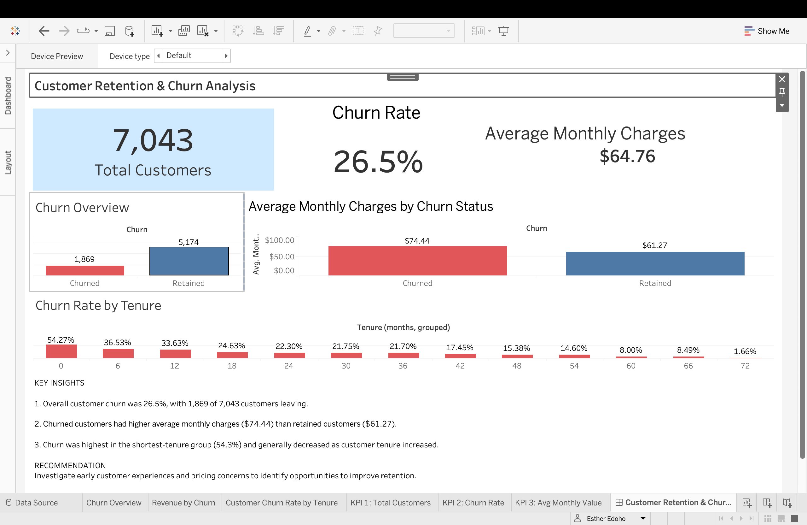

# Customer Retention & Churn Analysis | Tableau

## Project Overview

Customer retention is important for businesses that depend on recurring revenue. Understanding why customers leave helps organisations identify potential risks, improve customer experiences, and make better decisions.

This project analyses customer churn patterns across 7,043 telecom customers using Tableau. It explores how customer tenure and monthly charges relate to churn and highlights areas where retention efforts could be prioritised.

## Business Objectives

- Measure overall customer churn and retention.
- Identify customer groups with higher churn rates.
- Compare average monthly charges between churned and retained customers.
- Translate findings into practical recommendations for improving customer retention.

## Dashboard Preview

## Key Performance Indicators

| Metric | Result |
|---|---|
| Total Customers | 7,043 |
| Churned Customers | 1,869 |
| Retained Customers | 5,174 |
| Churn Rate | 26.5% |
| Average Monthly Charges | $64.76 |

## Key Findings

**1. Customer churn**

Of the 7,043 customers analysed, 1,869 had churned, representing a churn rate of 26.5%.

**2. Monthly charges and churn**

Churned customers had higher average monthly charges ($74.44) than retained customers ($61.27). This suggests pricing may be worth investigating as a potential factor associated with churn.

**3. Customer tenure and retention**

Churn was highest among customers in the shortest-tenure group (54.3%) and generally decreased as customer tenure increased. Customers in the 72-month group had a churn rate of approximately 1.7%.

## Business Recommendations

- Investigate customer experiences during the first six months to identify potential retention challenges.
- Examine pricing, contract types, and service experiences to better understand differences between churned and retained customers.
- Use these findings to guide further customer segmentation and retention analysis.

## Tools and Data

- **Tableau:** Data visualisation, calculated fields, dashboard development, and analysis.
- **Dataset:** IBM Telco Customer Churn dataset.

## Project Files

- `dashboard.png` — Dashboard preview.
- `Customer Retention and Churn Analysis1.twbx` — Tableau workbook.

## How to Explore

Download the `.twbx` workbook and open it in Tableau to explore the visualisations and calculations.

## About Me

I am a software and data professional with experience developing applications, integrating data through APIs, and working with stakeholders to deliver practical solutions.

My work spans software engineering, data analytics, and machine learning. I use Python, SQL, JavaScript, and data visualisation tools to analyse information, identify patterns, and build solutions that support business decisions.

I am particularly interested in using technology and data to improve processes, understand complex problems, and deliver measurable value.
